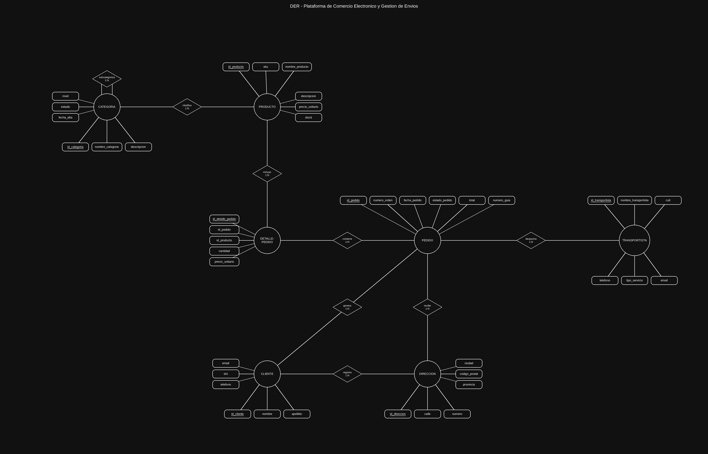
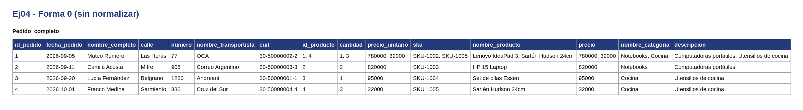
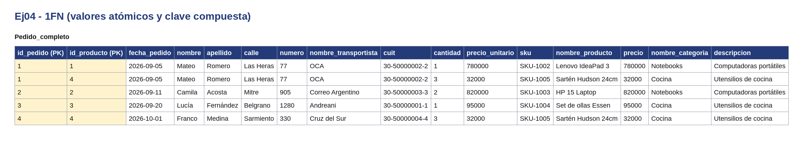
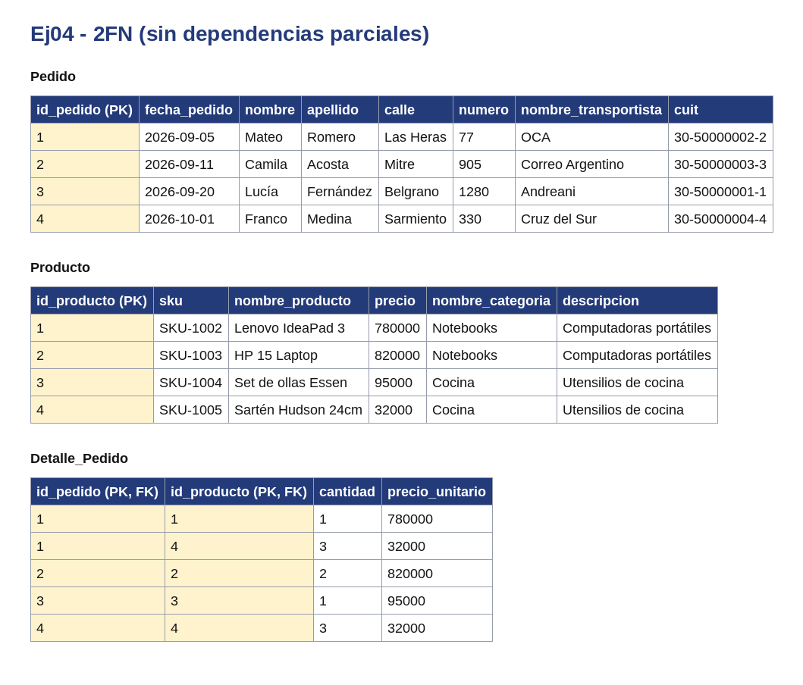
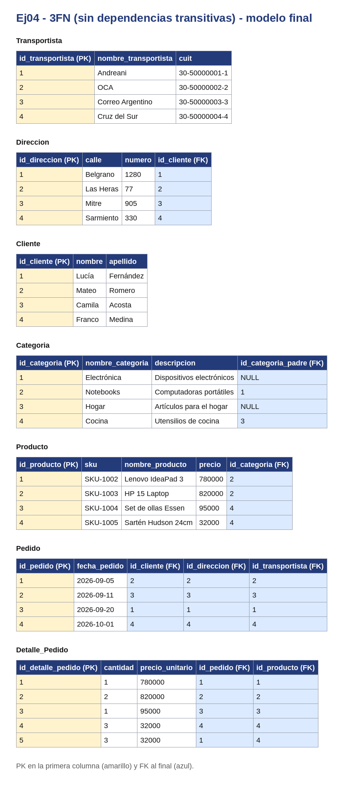

# ComercioElectronico

Base de Datos - Unidad 2 - Ejercicio 4

## Consigna
Modelar el esquema de datos de una plataforma de comercio electrónico, contemplando categorías de productos (con subcategorías), productos, clientes, direcciones de envío, pedidos, el detalle de cada pedido y el transportista que lo despacha.

## Lógica
- **CATEGORIA** se autorrelaciona (`subcat`, 1:N) para permitir categorías padre/hijo, y se relaciona 1:N con **PRODUCTO** (`clasifica`), ya que una categoría agrupa varios productos.
- **CLIENTE** se relaciona 1:N con **DIRECCION** (`registra`, un cliente puede tener varias direcciones) y 1:N con **PEDIDO** (`genera`).
- **DIRECCION** se relaciona 1:N con **PEDIDO** (`recibe`), indicando a qué dirección se envía cada pedido.
- **TRANSPORTISTA** se relaciona 1:N con **PEDIDO** (`despacha`).
- La relación M:N entre **PEDIDO** y **PRODUCTO** se resolvió con la entidad intermedia **DETALLE_PEDIDO**, conectada con 1:N a **PEDIDO** (`contiene`) y 1:N a **PRODUCTO** (`incluye`). Esta entidad guarda los datos propios de esa línea de pedido (cantidad, precio al momento de la compra, etc.), ya que el precio del producto puede cambiar con el tiempo y necesitamos el valor histórico.

## Resultado

---

## Normalización

Se normaliza el documento `Pedido` con sus registros de `Detalle_Pedido`. En todas las tablas la PK va en la primera columna y las FK al final. Los datos son de ejemplo.

**Forma 0.** Una sola tabla con todo junto. Hay celdas con listas: cada pedido puede tener varios registros de detalle pedido, y los nombres vienen completos en una sola columna.

**1FN.** Se separan nombre y apellido. Cada elemento de la lista pasa a su propia fila y la clave queda compuesta: (`id_pedido`, `id_producto`).

**2FN.** Los datos de pedido dependen solo de `id_pedido` y los de producto solo de `id_producto`. Se separan en `Pedido` y `Producto`; `Detalle_Pedido` queda con la clave compuesta y lo que depende de ambos.

**3FN.** Los datos de `Cliente`, `Direccion`, `Transportista` y `Categoria` dependen de su propio identificador y no de la PK de pedido, así que pasan a tablas aparte. En el modelo final cada tabla usa su id propio.

Para que se vea la lista en la Forma 0, se agregó un registro de ejemplo en `Detalle_Pedido` para el pedido 1.

---

## SQL

El script `script.sql` crea las tablas con sus claves primarias y foráneas y carga datos de ejemplo. Está probado en SQLite (con `PRAGMA foreign_keys = ON;`).
